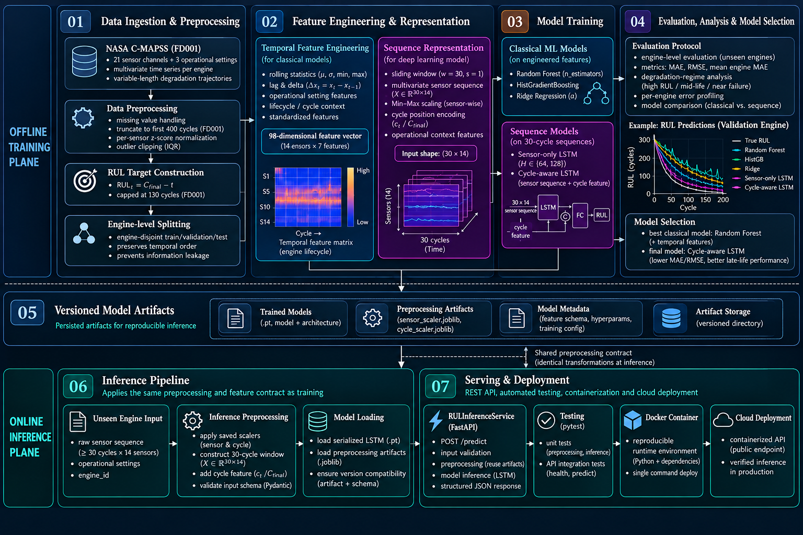

# AeroSentinel

### Aircraft Engine Remaining Useful Life Prediction

Machine Learning Engineering | Predictive Maintenance | Deep Learning | Model Deployment

AeroSentinel is an end-to-end machine learning project developed to estimate the Remaining Useful Life (RUL) of aircraft engines using NASA's C-MAPSS FD001 turbofan degradation dataset.

The project covers data preprocessing, experimental design, classical machine learning benchmarks, temporal feature engineering, deep learning, model evaluation, explainability, automated testing, and containerized inference.

The final system uses a cycle-aware Long Short-Term Memory (LSTM) model implemented in PyTorch. A FastAPI backend handles prediction requests, while Docker provides a consistent environment for running the inference service.



## Performance Highlights

| Metric | Result |
|---|---:|
| Official FD001 Test MAE | 16.75 cycles |
| Official FD001 Test RMSE | 23.28 cycles |
| Development Validation MAE | 17.46 cycles |
| Development Validation RMSE | 25.05 cycles |
| Official Test Engines | 100 |
| Automated Tests | 30 passed |
| Inference Window | 30 cycles |
| Selected Sensors | 14 |

The final model was evaluated on the official FD001 test set using the established inference configuration. Development validation and official test results are reported separately.

## 1. Problem Definition

Remaining Useful Life prediction estimates the number of operational cycles remaining before an engine reaches the end of its useful operating life.

The NASA C-MAPSS FD001 dataset contains simulated engine degradation trajectories with operational cycles, operating conditions, and sensor measurements.

The main challenges addressed in this project include:

- Modeling nonlinear degradation patterns from sensor measurements.
- Capturing temporal dependencies across operating cycles.
- Preventing data leakage between individual engine trajectories.
- Comparing classical machine learning models with sequence-based neural networks.
- Evaluating model generalization on unseen engines.
- Maintaining consistent preprocessing between training and inference.

AeroSentinel addresses these challenges through a structured experimental workflow and a separate inference service.

## 2. System Architecture

The project consists of two main components.

### Offline Model Development

The development pipeline includes data loading, validation, engine-aware splitting, feature engineering, model training, comparative evaluation, and artifact persistence.

Classical regression models were evaluated alongside LSTM architectures to compare predictive performance and assess the value of temporal modeling.

The selected model and preprocessing artifacts were saved for subsequent inference.

### Online Inference

The inference pipeline processes incoming API requests through the following stages:

1. Request validation using Pydantic.
2. Engine history and sensor validation.
3. Chronological sorting of observations.
4. Application of the saved sensor scaler.
5. Extraction of the latest 30-cycle window.
6. Transformation of the ending-cycle feature.
7. Tensor construction and LSTM inference.
8. Generation of the RUL prediction response.

The FastAPI application initializes the inference service during startup. Docker packages the application, its dependencies, and the required model artifacts.

## 3. Data Processing and Experimental Protocol

### Engine-Aware Dataset Partitioning

The development dataset was divided at the engine level rather than randomly splitting individual observations.

This prevents measurements from the same engine from appearing in both the training and validation partitions.

The development protocol used:

- 80 engines for development training.
- 20 engines for development validation.
- 100 development engines for final model training.
- 100 engines in the official FD001 test evaluation.

The official test set was evaluated separately from the model development and selection process.

### RUL Target Construction

RUL targets were calculated using the remaining number of operating cycles in each engine trajectory.

The project used uncapped RUL targets, preserving the full target range rather than imposing a maximum RUL threshold.

Engine identifiers and cycle ordering were maintained throughout preprocessing and sequence construction.

### Sensor Selection

The final model uses 14 selected sensor measurements:

`2, 3, 4, 7, 8, 9, 11, 12, 13, 14, 15, 17, 20, 21`

Each inference input contains the latest 30 observations for these sensors.

The resulting sensor sequence has 30 time steps and 14 features. A standardized ending-cycle value is provided as an additional model input.

## 4. Model Development

### Classical Machine Learning Benchmarks

Classical regression experiments were conducted to establish reference performance before selecting the final sequence-based model.

The development workflow included:

- Classical regression model comparison.
- Temporal feature engineering and refinement.
- Engine-level prediction analysis.
- Error analysis across different RUL ranges.
- Feature and sensor importance analysis.
- Random Forest and LSTM performance comparison.

The corresponding results, evaluation outputs, and diagnostic figures are retained in the repository.

### Cycle-Aware LSTM

The final architecture uses an LSTM to process multivariate sensor sequences together with a separate operational-cycle feature.

The sequence input represents recent sensor behavior, while the standardized ending-cycle feature provides additional information about the engine's operational age.

| Component | Configuration |
|---|---|
| Sequence Length | 30 cycles |
| Sensor Features | 14 |
| Sensor Tensor Shape | `(1, 30, 14)` |
| Cycle Tensor Shape | `(1, 1)` |
| Additional Feature | Standardized ending cycle |
| Inference Device | CPU |
| Final Training Protocol | 100 development engines |

The final model uses the saved preprocessing transformations during inference. No scalers are refitted when processing a prediction request.

## 5. Comparative Model Evaluation

The following results were obtained during development validation.

| Model | MAE | RMSE |
|---|---:|---:|
| Cycle-Aware LSTM | 17.46 | 25.05 |
| Sensor-Only LSTM | 18.01 | 26.67 |
| Random Forest (Depth 12) | 21.36 | 29.39 |

The cycle-aware LSTM achieved:

- 21.36% lower MAE than the Random Forest benchmark.
- 14.78% lower RMSE than the Random Forest benchmark.
- 3.03% lower MAE than the sensor-only LSTM.

These improvements were measured on the development validation data and should not be interpreted as official test comparisons between all three models.

### Lifecycle-Specific Error Analysis

Performance was also examined across different remaining-life ranges.

| RUL Region | Cycle-Aware LSTM MAE |
|---|---:|
| Near Failure | 4.17 |
| Medium RUL | 12.90 |
| High RUL | 27.41 |

The model achieved lower prediction errors near failure, while errors increased substantially in the high-RUL region.

The high-RUL evaluation also produced a mean signed error of approximately -18.01 cycles, indicating a tendency toward underprediction in that region.

These results show why aggregate evaluation metrics should be considered alongside lifecycle-specific error analysis.

## 6. Official NASA Test Evaluation

The locked cycle-aware LSTM was evaluated on the official FD001 test set after completion of the development process.

| Metric | Result |
|---|---:|
| Test Engines | 100 |
| MAE | 16.7479 cycles |
| RMSE | 23.2781 cycles |
| Median Absolute Error | 10.6517 cycles |
| 95th Percentile Absolute Error | 48.9542 cycles |
| Mean Signed Error | +12.6185 cycles |

The positive mean signed error indicates that the model tended to overpredict RUL on the official test set.

These values represent the recorded final evaluation results. They were not obtained through additional test-set model selection.

The corresponding metrics and engine-level predictions are available in the `outputs/` directory.

## 7. Explainability and Error Diagnostics

The project includes additional analysis to examine model behavior beyond overall MAE and RMSE.

The evaluation workflow covers:

- Sensor importance analysis.
- Lifecycle-specific sensor importance.
- Random Forest feature-family importance.
- Permutation importance.
- Training and validation histories.
- Engine-level prediction diagnostics.
- Error analysis across RUL ranges.

These analyses help identify which input features influence model behavior and where prediction errors are more pronounced.

Feature importance results are treated as model diagnostics rather than direct causal explanations of physical engine degradation.

## 8. Production Inference Engineering

A reusable `RULInferenceService` handles model loading, input preprocessing, validation, and prediction.

This separates the machine learning logic from the FastAPI request-handling layer.

### Saved Model Artifacts

The inference service loads three finalized artifacts:

```text
models/saved_artifacts/
    fd001_final_cycle_aware_lstm.pt
    fd001_final_cycle_feature_scaler.joblib
    fd001_final_sequence_sensor_scaler.joblib
```

The checkpoint contains the trained model parameters and configuration metadata. The saved scalers preserve the preprocessing transformations used by the final model.

### Inference Validation

Before generating a prediction, the service validates:

1. Required engine-history columns.
2. Numeric and finite sensor values.
3. Single-engine request consistency.
4. Positive engine identifiers and cycle values.
5. Duplicate cycle values.
6. Minimum 30-observation requirement.
7. Model checkpoint configuration.
8. Sensor order and preprocessing artifact compatibility.

After validation, observations are sorted by cycle and the latest 30-cycle window is selected.

The saved preprocessing transformations are applied before constructing the PyTorch tensors and executing the LSTM.

The inference service initializes the model and scalers during FastAPI startup, avoiding repeated artifact loading for each request.

## 9. REST API

The inference API is implemented using FastAPI, Pydantic, and Uvicorn.

| Endpoint | Method | Description |
|---|---|---|
| `/health` | GET | Returns application health status |
| `/predict` | POST | Generates an engine RUL prediction |
| `/docs` | GET | Provides interactive API documentation |

### Prediction Request

The prediction endpoint accepts an engine identifier and a sequence of observations containing cycle information and the 14 required sensor measurements.

At least 30 valid observations are required.

### Prediction Response

A successful request returns:

- `engine_id`
- `last_observed_cycle`
- `predicted_rul`

The API distinguishes schema validation failures, domain-specific input errors, and unexpected inference failures through appropriate HTTP responses.

## 10. Automated Testing

The project uses pytest and FastAPI TestClient for automated validation and integration testing.

The test suite covers:

- Engine-history validation.
- Sensor and cycle constraints.
- Missing or invalid observations.
- Minimum sequence requirements.
- Model and scaler loading.
- Artifact compatibility checks.
- Inference service initialization.
- Successful prediction responses.
- API request validation.
- HTTP error handling.

### Verified Test Result

```text
30 passed, 4 warnings in 4.75s
```

Run the test suite with:

```bash
uv run python -m pytest tests/ -q
```

The tests passed with non-failing warnings related to dependency compatibility and tensor construction.

These include a scikit-learn version mismatch between saved artifacts and the current runtime, a NumPy array-writability warning, and a Starlette TestClient deprecation warning.

The saved scikit-learn artifacts should be checked against their original dependency versions when reproducing inference in another environment.

## 11. Docker Containerization

The inference backend is packaged as a Docker image containing the Python runtime, application source code, dependencies, and final inference artifacts.

The container environment uses:

- Python 3.12.
- FastAPI and Uvicorn.
- CPU-based PyTorch inference.
- NumPy, pandas, and scikit-learn.
- uv for dependency management.
- Saved model and preprocessing artifacts.

### Build the Docker Image

From the project root:

```bash
docker build -t nasa-cmapss-rul-api .
```

### Run the Container

```bash
docker run --rm -p 127.0.0.1:8000:8000 nasa-cmapss-rul-api
```

### Verify the API

```bash
curl http://localhost:8000/health
```

Interactive API documentation is available at:

`http://localhost:8000/docs`

The local Docker deployment has been verified through successful container startup, health checks, prediction requests, and container recreation.

## 12. Repository Structure

```text
AeroSentinel/
    src/
        api/
        data/
        modeling/
        evaluation/
        inference/
        config.py
    models/
        saved_artifacts/
    tests/
    outputs/
    notebooks/
    docs/
        assets/
            aerosentinel_architecture.png
    Dockerfile
    .dockerignore
    pyproject.toml
    uv.lock
    README.md
```

The repository contains both experimental outputs and the artifacts used by the final inference system.

The `outputs/` directory preserves model comparisons, evaluation metrics, predictions, and diagnostic visualizations.

The final checkpoint and scalers are stored separately from the experimental analysis results.

## 13. Reproducibility and Project Scope

Project dependencies are defined in `pyproject.toml`, with resolved versions recorded in `uv.lock`.

Docker provides a consistent Linux environment for running the inference application independently of the original Windows development setup.

The project preserves evaluation outputs and final inference artifacts to support inspection of the model development process.

AeroSentinel is an engineering demonstration based on the NASA C-MAPSS FD001 benchmark. It is not intended as a certified aircraft maintenance or operational decision-making system.

## 14. Technology Stack

| Area | Technologies |
|---|---|
| Programming | Python |
| Machine Learning | PyTorch, Scikit-learn |
| Data Processing | NumPy, Pandas |
| Backend | FastAPI, Pydantic, Uvicorn |
| Testing | pytest, HTTPX |
| Dependency Management | uv |
| Containerization | Docker |
| Version Control | Git, GitHub |

---

AeroSentinel is a complete machine learning development and inference project combining experimental evaluation, temporal modeling, automated validation, and containerized model serving.
